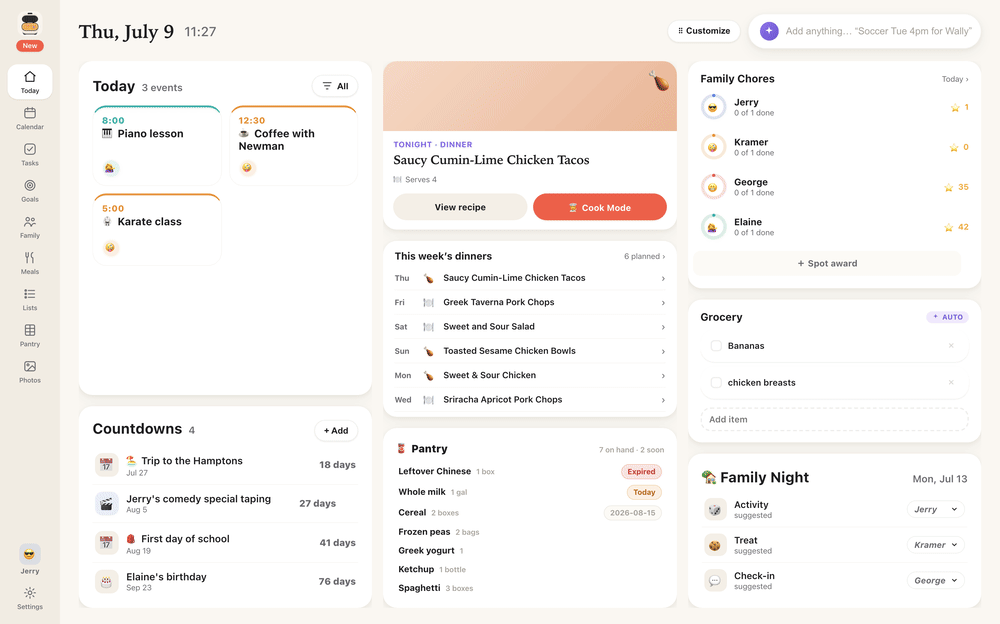

<p align="center">
  
</p>

<h1 align="center">Waffled — Family Hub</h1>

<p align="center">
  <strong><a href="https://docs.waffled.app">📖 Documentation</a></strong>
  &nbsp;·&nbsp; <a href="#self-hosting-quickstart">Quickstart</a>
  &nbsp;·&nbsp; <a href="https://github.com/evan-ribbey/waffled-ng/releases">Releases</a>
</p>

<p align="center">
  
</p>

A shared family operating system you open in any browser:

- **Counter Kiosk** — always-on tablet (1280×800), full read/write, ambient display. Runs as the web app in fullscreen/PWA mode.
- **Web app / PWA** — the full management and setup dashboard (same build as the kiosk). Install it to a phone's home screen for quick capture.

One household, one source of truth: calendar (2-way Google **or** Outlook sync, plus
read-only ICS feeds), chores & stars,
goals & rewards, meals & recipes, lists, photos, and an AI "Add anything" capture bar.

## Repo layout

```
compose.yaml   the whole install: waffled + Postgres (+ optional backup)
Dockerfile     builds the single waffled image (web SPA + api)
apps/
  api/         backend (lambda-api); serves the SPA and /media too; calendar sync runs in-process
  web/         React SPA — also the kiosk layout (same build, fullscreen/PWA mode)
infra/backup/  the optional backup image
scripts/       release.sh (maintainers), smoke-compose.sh (CI)
docs/          ARCHITECTURE.md, DATA_MODEL.md, TESTING.md, product/ (user docs)
```

## Self-hosting (quickstart)

Waffled runs as two containers: one `waffled` app image (it serves the web app, the API and
uploaded media) and Postgres. Auth is **built in** — no Auth0 or external identity provider
required. You can optionally attach your own SSO later (see below).

You need **Docker with Compose v2.24 or newer** (Docker Desktop, or Docker Engine plus the
Compose plugin). Then:

```bash
mkdir waffled && cd waffled
curl -fsSLO https://raw.githubusercontent.com/evan-ribbey/waffled-ng/main/compose.yaml
docker compose up -d
```

Open `http://localhost:8080`. On first load you'll get a **setup wizard**: enter a household
name + timezone and create your **admin account** (name, email, password). That's it.

No `.env`, no API keys, no generated secrets to manage: on first start the app creates its
signing and encryption keys in the `waffled_data` volume and reuses them. (To build from a
clone instead, run `docker compose up -d --build`.)

> **Using it from a tablet or phone?** Open `http://<your-ip>:8080` on the device. For a
> hostname or HTTPS, see [Behind a reverse proxy](#behind-a-reverse-proxy).

### Settings (`.env`)

Every setting is optional. To change one, copy [`.env.example`](.env.example) to `.env`
**beside `compose.yaml`**, uncomment what you need, and run `docker compose up -d` again.
Settings must live in that file: variables exported in your shell do not reach the
containers. Common ones: `HTTP_PORT`, `POSTGRES_*` (set before the first start),
`ANTHROPIC_API_KEY` / `OPENAI_API_KEY` / `OLLAMA_HOST` for the AI capture bar, and
`GOOGLE_CLIENT_ID` / `GOOGLE_CLIENT_SECRET` / `GOOGLE_CALENDAR_REDIRECT_URI` (or the
matching `MS_*` values) for 2-way Google / Outlook calendar sync. ICS calendar feeds need
no credentials at all.

### Behind a reverse proxy

Waffled speaks plain HTTP on the published port. To serve it at `https://waffled.example.com`,
put any reverse proxy you control (Caddy, nginx, Traefik, a Cloudflare Tunnel) in front of
`localhost:8080` and add to `.env`:

```bash
PUBLIC_BASE_URL=https://waffled.example.com   # origin used for OAuth/OIDC redirect URLs
TRUST_PROXY=true                              # honour X-Forwarded-* headers
```

Set `TRUST_PROXY=true` **only** behind a proxy you control; with it on, a client that can
reach the port directly can spoof its address past the rate limiter. Leave it unset when
you expose the port straight to your LAN.

### Upgrading

```bash
docker compose pull && docker compose up -d
```

Migrations run automatically on start. There is no automatic backup before an upgrade, so
turn on backups first if you want a rollback point. Pin a release with `WAFFLED_VERSION`
in `.env`. Waffled also checks GitHub for new releases and shows **Settings → System Health
→ "Update available"** (disable with `UPDATE_CHECK_ENABLED=false`). More in the
[upgrading guide](website/docs/src/content/docs/operations/upgrading.md).

**Coming from the old `./waffled` install?** See the
[migration guide](website/docs/src/content/docs/install/migrating-from-waffled-cli.md).

### Backups and restore

```bash
docker compose --profile backup up -d                 # nightly dumps; also set BACKUP_ENABLED=true in .env
docker compose exec -u postgres backup waffled-backup # run one now
docker compose stop waffled && docker compose run --rm --no-deps backup restore <file>
docker compose start waffled
```

Set `BACKUP_ENABLED=true` in `.env` so System Health tracks them. Keep `--no-deps` on
restore: it refuses to run while the app is connected to the database. Details:
[Backup & restore](website/docs/src/content/docs/operations/backup.md).

### Demo data

```bash
for phase in base meals goals; do
  docker compose exec -u node -e WAFFLED_ALLOW_DEMO_SEED=1 waffled node dist/seed-demo.js $phase
done
```

The seed refuses to run without `WAFFLED_ALLOW_DEMO_SEED=1`, and takes the phases in order.

### Cutting a release (maintainers)

```bash
scripts/release.sh 0.17.0
```

It bumps the `apps/api` and `apps/web` versions (and lockfiles), dates the `[Unreleased]`
changelog section, commits `release: v0.17.0` and tags it. It never pushes: it prints the
push command, and pushing the `v*` tag is what triggers the image publish workflow.

### Adding family members

Settings → **Family & people** → *Add a person* creates a profile. To let someone
sign in, open their card and use the **Login** section: give them an email (+ optional
password). Email-only members can sign in via SSO once OIDC is configured.

### Single sign-on (OIDC) — optional

Waffled supports backend-mediated OIDC (auth-code + PKCE) against any OpenID-Connect
provider (Authentik, Keycloak, Google, …). It's **invite-gated**: a person can only
sign in via SSO if the provider's *verified email* already matches a family member's
login email. Configure it in **Settings → Login & security** (installation owner only):

1. Ensure `TOKEN_ENCRYPTION_KEY` is set (the client secret is encrypted at rest).
2. **Issuer URL** — your provider's discovery base, e.g.
   `https://accounts.google.com` or `https://auth.example.com/application/o/waffled/`.
   Click **Test** to confirm Waffled can reach its discovery document.
3. **Client ID** + **Client secret** from an OIDC app you register at the provider.
4. Register this **redirect URI** at the provider:
   `https://your.host/api/auth/oidc/callback` (use `http://localhost:8080/...` locally).
5. Toggle **Single sign-on** on → **Save SSO settings**. Optionally turn off password
   login to force SSO (only allowed once OIDC is saved, so you can't lock yourself out;
   set `AUTH_FORCE_PASSWORD=1` in the env as a break-glass override).

**Reusing your Google Calendar OAuth client for sign-in:** yes — a single Google Cloud
"Web application" OAuth client works for both. Add the OIDC callback above to that
client's *Authorized redirect URIs* (alongside the calendar one), set the issuer to
`https://accounts.google.com`, and reuse the same client ID/secret. The sign-in scopes
(`openid email profile`) are non-sensitive, so no extra Google verification is needed.

The redirect URI Waffled sends to the IdP is derived from the host the request arrives
on, so behind a hostname set **`PUBLIC_BASE_URL`** to pin one stable callback, then register
just that one.

### Operator commands (admin CLI)

Break-glass / recovery commands for when the web UI can't help — e.g. the only admin
is locked out, SSO is misconfigured, or a Google token died. They run **inside the waffled
container**, so they reach the database
and the encryption key directly with **no login or admin token required** — physical/SSH
access to the host *is* the authorization. Auth writes go through the same scrypt hashing
and credential→identity wiring the API uses, so there's one source of truth.

```bash
docker compose exec -u node waffled node dist/admin.js help           # list every command
docker compose exec -u node waffled node dist/admin.js list-members   # people, login email, admin/owner, password/SSO
```

Use `-u node` so any files the command writes under `/data` stay owned by the app user.

| Command | What it does |
| --- | --- |
| `list-members` | List everyone with their login email, admin/owner status, and whether they have a password and/or SSO identity. |
| `reset-password --email <e> [--password <pw>]` | Set a member's password by login email (the headline use case: locked-out admin, no SSO). Generates a strong one and prints it if `--password` is omitted, and revokes their active sessions **across all of their households**. |
| `add-member --email <e> --household-id <uuid> [--member-type adult\|teen\|kid] [--admin]` | Attach an **existing** account to another household directly — the break-glass alternative to the web Households → invite-and-accept flow. The account must already exist (the human has signed in at least once); idempotent if they're already a member. |
| `list-accounts` | List each human (account) and every household they belong to, with an owner/admin/member marker. |
| `make-admin (--email <e> \| --person <uuid>)` | Grant admin. |
| `revoke-admin (--email <e> \| --person <uuid>)` | Revoke admin (the household owner can't be demoted). |
| `set-installation-owner --email <e>` | Transfer or recover ownership of installation-wide login and SSO settings. This is a host-level break-glass action. |
| `password-login <on\|off>` | Enable/disable email+password login (the DB toggle mirrored in Settings → Login & security). |
| `clear-calendar-error (--email <e> \| --all)` | Clear a stuck Google account's "sync failing" flag. (The token itself is fixed by **Reconnect** in Settings → Calendars — a browser OAuth step the CLI can't do.) |
| `prune-sessions [--email <e>]` | Revoke refresh tokens for one member (**across all of their households**), or everyone — forces re-login. |
| `list-households` | List every household with its member + login counts, created date, and id. |
| `delete-household --id <uuid> [--force]` | Permanently delete a household and **all** of its data (handy for clearing test debris). Refuses a household that has logins unless you add `--force`. |

Destructive commands (`reset-password`, `clear-calendar-error`, `prune-sessions`,
`delete-household`) prompt for a `y` confirmation; pass `--yes` to run them
non-interactively (e.g. over plain SSH).

> **Hard lockout, no admin at all?** If password login is off and SSO is broken, set
> `AUTH_FORCE_PASSWORD=1` in `.env` (beside `compose.yaml`) and run `docker compose up -d`.
> That forces the password form back on regardless of the DB toggle; then use
> `reset-password` (above) to get in.

## Start here

1. Run it — the [Self-hosting quickstart](#self-hosting-quickstart) above (`docker compose up -d`).
2. Read `docs/ARCHITECTURE.md` — the decisions and why.
3. Read the docs site (built from `website/docs/`, Astro Starlight) — the user-facing docs and the feature matrix (source: `website/docs/src/content/docs/reference/features.md`).
4. Follow `docs/engineering-plan.md` — the milestone plan in bite-sized, committable chunks.

> Only setting up calendar sync? The **Google Calendar** and **Outlook / Microsoft 365** admin
> guides on the docs site (`website/docs/src/content/docs/administration/`) have the
> OAuth-client walkthroughs. Subscribing to a published ICS link needs no setup at all.

## The stack in one breath

Self-hosted Docker Compose, two containers · Postgres system-of-record · one `waffled` image
serving the SPA, API and `/media` · **built-in email/password auth + optional OIDC SSO** (no
Auth0) · Google Calendar authoritative for Google-origin events, Waffled authoritative for
native fields · ~5-min in-process calendar sync (no separate worker) · put your own reverse
proxy in front for HTTPS · everything in this one repo.

## License

Waffled is licensed under the **GNU Affero General Public License v3.0** (AGPL-3.0). See
[LICENSE](LICENSE). In short: you're free to self-host, study, modify, and share it — but
if you run a modified version as a network service, you must make your source available to
its users under the same license.
